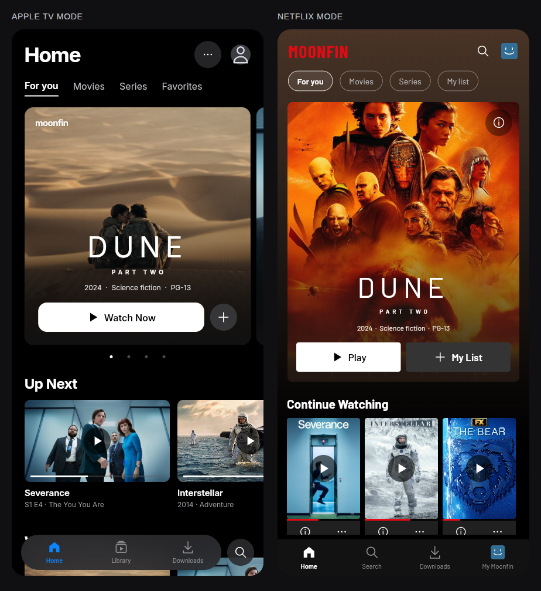

# Moonfin mobile cinema

Two mobile presentations built from the same native Flutter components used by
Moonfin's home screen:

- **Apple TV:** an editorial Home header, paging artwork, SF system typography on
  Apple devices (bundled Inter fallback elsewhere), rounded Watch Now controls,
  landscape Up Next cards, and floating glass navigation with a separate search
  control.
- **Netflix:** a condensed brand wordmark, poster-led discovery, paired rectangular
  Play / My List controls, portrait Continue Watching cards with red progress,
  outlined ranking numerals for curated demo picks, and a flat navigation bar.

Switch modes through **Appearance** (the more control in Apple TV mode, the
wordmark in Netflix mode) or the profile screen. The app saves this per profile.
The original home is available by disabling **Cinematic mobile home** in
Settings → Home Screen. TV, desktop, and Kids Mode retain their existing home.



The new UI package uses Flutter widgets and Cupertino primitives. It contains
no Material buttons, cards, tabs, icon fonts, sheets, snackbars, or ink effects.
Buttons, symbols, focus and press states, progress tracks, navigation, and
transient notices are purpose-built. Detail sheets, search, profile, downloads
preview and playback preview use the same component language.

## Run the interactive preview

Use Flutter 3.47.2 (the same version as the main app):

```sh
cd examples/mobile_ui
flutter pub get
flutter run -d web-server --web-hostname 127.0.0.1 --web-port 8077
```

Alternatively, `flutter build web --release --no-wasm-dry-run` produces a static
preview in `build/web`. Serve that directory with any local HTTP server.
The `?mode=appleTv` and `?mode=netflix` query parameters select the initial mode.

The preview includes category filters, swipeable featured titles, details,
search, saved titles, profile controls, and local persistence. Its catalog is
fixture data; its playback button explains the connection required for playback.
The main app uses the existing server, cache, library navigation, favorites API,
and playback routes instead. No preview data is used in the main app.

## Source and checks

- Reusable UI: `packages/mobile_ui/lib/`
- App adapter: `lib/ui/screens/home/mobile_home_content.dart`
- Native integration: `lib/ui/screens/home/home_screen.dart`
- Fixtures and preview: this directory

```sh
cd packages/mobile_ui
flutter pub get
flutter test
dart analyze lib test
```

Widget tests cover the absence of Material surfaces, presentation switching,
keyboard activation, navigation, category filters, playback callbacks, favorite
persistence and rollback, Cupertino loading/empty states, and both layouts on
320px screens at standard and double text size.

The core app's search, downloads, account management, full details and player
routes remain available through their existing flows; the new home, navigation,
appearance panel and quick details are integrated directly. The isolated preview
also demonstrates the redesigned search and supporting pages without a server.

## Typography

Inter, Barlow, and Barlow Condensed are bundled under the SIL Open Font License.
Their licenses are included alongside the fonts in
`packages/mobile_ui/assets/fonts/`. Apple system fonts are referenced by family
name on supported devices; no proprietary Apple or Netflix fonts are bundled.

## Preview artwork

Artwork is used only in the local design preview. Film and television artwork
belongs to its respective owners. These files are not part of the mobile UI
package or the production app's asset bundle.

Poster and still sources: [TMDB](https://www.themoviedb.org/).
This preview is not endorsed or certified by TMDB.

| Asset | Source |
| --- | --- |
| Dune: Part Two poster | [TMDB image](https://image.tmdb.org/t/p/w500/1pdfLvkbY9ohJlCjQH2CZjjYVvJ.jpg) |
| Dune: Part Two still | [Movieplayer / Warner Bros. publicity still](https://movieplayer.net-cdn.it/t/images/2024/02/21/dune-parte2_1_wNPBKVW_jpg_1280x720_crop_q85.jpg) |
| Severance poster | [TMDB image](https://image.tmdb.org/t/p/w500/pPHpeI2X1qEd1CS1SeyrdhZ4qnT.jpg) |
| Severance still | [TMDB image](https://image.tmdb.org/t/p/w780/ixgFmf1X59PUZam2qbAfskx2gQr.jpg) |
| Interstellar poster | [TMDB image](https://image.tmdb.org/t/p/w780/gEU2QniE6E77NI6lCU6MxlNBvIx.jpg) |
| Interstellar still | [TMDB image](https://image.tmdb.org/t/p/w780/rAiYTfKGqDCRIIqo664sY9XZIvQ.jpg) |
| The Bear artwork | [TMDB image](https://image.tmdb.org/t/p/w500/sHFlbKS3WLqMnp9t2ghADIJFnuQ.jpg) |
| Arrival artwork | [TMDB image](https://image.tmdb.org/t/p/w500/x2FJsf1ElAgr63Y3PNPtJrcmpoe.jpg) |
| Foundation poster | [TMDB image](https://image.tmdb.org/t/p/w780/o4v4hk5To5YS6so4huMgblu0OQM.jpg) |
| Foundation still | [TMDB image](https://image.tmdb.org/t/p/w780/q3jHCb4dMfYF6ojikKuHd6LscxC.jpg) |
